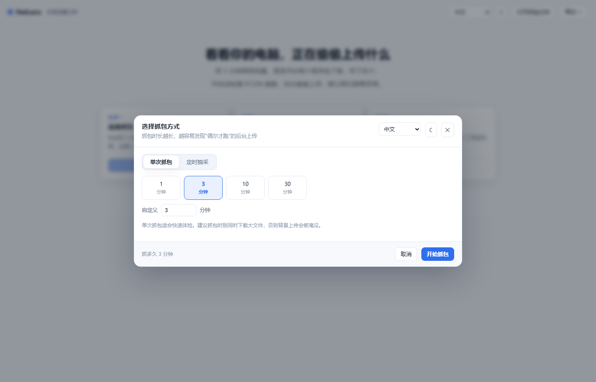

# NetLens

> 看看你的电脑，到底在偷偷上传什么。

双击 `NetLens.exe`，抓 **3 分钟**（可自选 1/10/30 分钟，或定时抽采）网络流量，在浏览器里告诉你**每个程序连了谁、传了多少**，
并自动检查 **PCDN 偷跑 / 后台偷偷上传 / 被公网扫描**。

界面支持 **中文 / English / 日本語 / 한국어 / Português**，明暗主题一键切换（默认浅色）。


<p align="center">
  <a href="#系统要求"></a>
  <a href="LICENSE"></a>
  <a href="#它是怎么做到的"></a>
  <a href="#常见问题"></a>
</p>

---

## 太长不看

1. 下载 [最新版](https://github.com/JesseBa1/NetLens/releases/latest) 的 zip，解压
2. 双击 **`NetLens.exe`** → UAC 点「是」→ 浏览器自动打开 → 在网页里选抓多久
3. 等它抓完（默认 3 分钟，可改 1/10/30 分钟或定时抽采），浏览器自动弹出结果

不用装 Wireshark、不用装 Python、不用联网。分析全程在你自己的浏览器里完成。

---

## 它能回答什么问题

| 你可能担心的事 | NetLens 怎么看 |
|---|---|
| 电脑里是不是有东西在偷偷上传？ | 列出每个进程的上传量，并区分「协议开销」和「真正的内容上传」 |
| 是不是有人拿我的宽带跑 PCDN？ | 检查单个程序是否在向**几十个陌生 IP** 同时上传 |
| 我的电脑有没有暴露在公网？ | 统计抓包期间有没有**外部 IP 主动连进来** |
| 到底是谁在占带宽？ | 按进程 / 远端 IP / 连接三个维度列出流量排行 |

---

## 30 秒上手

### 第 1 步：拿到工具

去 [Releases](https://github.com/JesseBa1/NetLens/releases/latest) 下载最新的 `NetLens-v*.zip`，
解压到任意文件夹（比如桌面）。**不要**在压缩包里直接双击。

### 第 2 步：双击 `NetLens.exe`

会弹出一个蓝色的"用户帐户控制"弹窗 → 点 **「是」**。程序缩到右下角托盘，浏览器自动打开分析页面。

> 托盘右键可以「打开界面 / 打开抓包目录 / 退出 NetLens」；退出会同时停掉后台服务。
> 没有 `NetLens.exe` 也可以双击 `NetLens.cmd`，功能一样，只是会保留一个控制台窗口。

> 为什么要管理员权限？抓包用的是 Windows 自带的 `pktmon` 驱动，必须管理员才能启用。
> 不想给权限也可以：只分析已有文件时不需要管理员。

### 第 3 步：选抓多久

浏览器打开后点「开始抓包」，会弹出选择窗口：



| 模式 | 适合 |
|---|---|
| **单次抓包 1 / 3 / 10 / 30 分钟**（可自定义） | 快速体检，看"现在有没有在偷跑" |
| **定时抽采 6 / 12 / 24 次**，每次 60 秒、每 10 分钟一次 | 找"偶尔才传"的软件：出现次数越多越可疑 |

默认 3 分钟。选完点「开始抓包」，窗口里会显示进度。

### 第 4 步：等它抓完

抓包期间**正常用电脑**就行（刷网页、看视频都可以），被抓的流量越"日常"，结果越有参考价值。
定时抽采会在每次采样的间隙自动等待，控制台和网页都会显示进度。

### 第 5 步：看结果

抓完浏览器会自动打开结果页，页面顶部会直接给结论：

> ✅ **没发现异常上传行为**
> 上下行比例、单条连接上传量、对端数量、入站连接都在正常范围内。

想细看就往下翻，或者点「异常判定」「进程」「连接明细」。
定时抽采还会多出一张「每次采样的结果」表，以及「出现次数」列。

完事后**直接关掉黑色窗口**即可，不会残留任何服务。

---

## 第一次运行可能遇到的弹窗

| 弹窗 | 是什么 | 怎么办 |
|---|---|---|
| 蓝色「用户帐户控制」 | Windows 在问你是否允许抓包 | 点「是」 |
| 「Windows 已保护你的电脑」 | 启动器没有代码签名，SmartScreen 的例行提示 | 点「更多信息」→「仍要运行」 |
| 杀毒软件提示 | 因为调用了抓包驱动 + 监听本地端口 | 允许即可；不放心可以只保留 `web` 目录做纯文件分析 |

---

## 结果怎么看（小白版）

### 顶部横幅：先看这一句

| 颜色 | 含义 |
|---|---|
| ✅ 绿色 | 7 项检查全过，没发现异常上传 |
| ⚠️ 黄色 | 有 1 项触发了阈值，点「异常判定」看具体是什么 |
| 🔴 红色 | 多项触发，建议逐项核对 |

黄色/红色**不等于中毒**。比如你装了 ToDesk、向日葵、Steam Link 这类远程串流软件，
「公网主动连入」就可能是正常的；装了代理软件，流量也会集中在代理进程上。

### 7 项检查分别是什么意思

| 检查项 | 说人话 |
|---|---|
| 持续上行速率 | 你整体上传得有多快。正常上网时上传通常只有下载的几十分之一 |
| 单条连接最大上传 | 有没有哪一条连接传了特别多东西（后台传大文件、备份照片） |
| 多对端上传 | 是否同时向很多陌生 IP 传数据 —— **PCDN 最典型的特征** |
| 公网主动连入 | 有没有外网机器主动连进来，说明有端口暴露或在被扫描 |
| UDP 对多 IP 发送 | UDP 是否在向很多 IP 发包，P2P/PCDN 常用这种方式 |
| 未归属进程的上行 | 有多少上传没能对应到具体程序（越少越好） |
| 上行峰值 | 瞬间最高上传速度，突发传大文件时会冲高 |

### 三个典型结果

**① 全绿，上行只有几百 KB**
→ 这段抓包期间没有偷传。可以把抓包时间拉长到 10 分钟再确认一次。

**② 黄色：多对端上传，某进程连了几十个陌生 IP**
→ 高度疑似 PCDN / P2P。去「进程」页看是哪个程序，不认识的直接卸载。

**③ 黄色：公网主动连入**
→ 你有服务暴露在公网。如果是远程软件就没事；如果不知道是什么，检查一下端口映射和防火墙。

---

## 界面里有什么

| 页签 | 看什么 |
|---|---|
| **抓包设置**（弹窗） | 单次 1/3/10/30 分钟或自定义、定时抽采 6/12/24 次 |
| **总览** | 上下行卡片、流量时间线、上传/下载排行；抽采模式换成「每次采样的结果」 |
| **异常判定** | 7 项检查的实测值和阈值 |
| **进程** | 每个程序传了多少、连了几个远端 |
| **远端 IP** | 流量都发到了哪些服务器 |
| **域名** | 能还原出的域名（HTTPS 加密，仅供参考） |
| **连接明细** | 每一条连接的上下行字节，可搜索过滤 |
| **使用说明** | 就是这篇文档的精简版，离线也能看 |
| **设置** | 抓包默认时长/抽采次数、手动指定本机 IP、去重说明 |

右上角还有 **语言切换**（中/英/日/韩/葡）和 **明暗主题** 按钮。

右上角「导出」可以存成 **Markdown 报告 / CSV / JSON**。

---

## 不抓包也能用

- **已有抓包文件**：直接把 `.pcapng` / `.pcap` 拖进网页（Wireshark、tcpdump 抓的都行），
  不需要管理员权限，也不需要启动服务。
- **只想看看长什么样**：双击 `web\index.html`，点「查看示例」，用内置示例数据体验。
- **只启动界面**：`NetLens.ps1 -ServeOnly`，然后在页面里拖文件。

---

## 常见问题

<details>
<summary><b>提示"无法与 PktMon 驱动程序通信，拒绝访问"</b></summary>

没有管理员权限。请从 `NetLens.cmd` 启动并在 UAC 点「是」。只做文件分析则不需要管理员。
</details>

<details>
<summary><b>3 分钟够吗？</b></summary>

3 分钟适合"现在有没有在偷跑"，不适合证明"从来没有"。3 分钟只占一天的 0.2%，如果某软件每天只上传 10 分钟，碰上的概率约 7%。

建议：快速体检用 3 分钟；怀疑某个软件时用 **10–30 分钟**，并且抓包时别同时下载大文件；想找"偶尔才传"的软件，用**定时抽采**（6/12/24 次），看它是不是每次都出现。
</details>

<details>
<summary><b>抓到的流量很少，是不是没抓到？</b></summary>

抓包期间电脑基本空闲，抓到的自然少，属正常。建议在你怀疑的场景下（比如开着某个软件）再抓一次。
</details>

<details>
<summary><b>为什么看不到具体网站？</b></summary>

HTTPS 是加密的，只能看到服务器 IP；如果还走了代理（Clash、v2ray 等），实际流量都在代理隧道里，
只能看到代理节点的 IP。想看具体站点需要代理软件自己的连接日志。
</details>

<details>
<summary><b>能抓别的电脑 / 手机吗？</b></summary>

不能。它只抓这台电脑的网卡，看不到手机、电视盒子、智能家居，也看不到路由器自己发起的流量。

想覆盖全家，需要看路由器后台的「每设备流量 / UPnP 映射」，或在路由器上抓包（OpenWrt 的 `nlbwmon` / `tcpdump`），或者把电脑当网关（热点/ICS）让其他设备走它。
</details>

<details>
<summary><b>数据会不会被上传到什么地方？</b></summary>

不会。抓包文件保存在本地 `captures\` 目录，解析在浏览器里完成，页面不发起任何外部请求。
</details>

<details>
<summary><b>端口 8765 被占用了</b></summary>

`NetLens.exe` 每次会随机挑一个空闲端口，不用担心冲突；用 `NetLens.cmd` 时从 8765 开始向后找，控制台会打印实际地址。
</details>

<details>
<summary><b>抓包文件太大 / 浏览器卡</b></summary>

默认按 1024 字节截断（`capture.ps1` 里的 `--pkt-size`），日志上限 4 GB。普通浏览 3 分钟约 20–200 MB，但在串流/大流量场景下 3 分钟可能到 1 GB 以上。
超过 20 分钟的抓包会自动降到 512 字节；万一还是撞到 4 GB 上限，页面顶部会提示"开头可能被覆盖"。
改成 `--pkt-size 0` 可抓完整包，但文件会大一个数量级。
</details>

---

## 它是怎么做到的

```
NetLens.cmd
   └─ NetLens.ps1        提权 → 抓包 → 起本地 HTTP 服务 → 开浏览器
        ├─ capture.ps1   pktmon 抓包 + 每秒采样连接表（用于把流量归到进程）
        └─ web/          纯静态页面，浏览器里解析 pcapng、算指标、画图
```

- **抓包**：Windows 自带 `pktmon`，不需要 Npcap/Wireshark
- **解析**：纯 JavaScript 手写 pcap/pcapng 解析器（`web/core.js`），无任何第三方库
- **进程归属**：抓包同时每秒记录 `本地端口 → PID`，事后把连接映射回进程
- **去重**：pktmon 会在驱动多个组件重复记录同一个包，按「五元组 + 序号 + 载荷指纹 + 3ms 窗口」合并
- **口径**：字节数按 IP 包长度统计（不含以太网帧头）；「应用层上行」= 去掉 TCP/IP 头和纯 ACK

---

## 高级用法

```powershell
.\NetLens.ps1 -Seconds 600          # 抓 10 分钟
.\NetLens.ps1 -Port 9000            # 指定端口
.\NetLens.ps1 -ServeOnly -NoBrowser # 只起服务，不开浏览器

# 定时抽采（需管理员）：12 次 × 60 秒，每 10 分钟一次
.\capture.ps1 -Seconds 60 -Series $true -Times 12 -Interval 600
```

- 重新编译启动器：`powershell -File build-exe.ps1`（需要系统自带的 csc.exe）
- 改判定阈值：`web/core.js` 的 `buildChecks()`
- 改抓包截断长度：`capture.ps1` 里的 `--pkt-size`
- 换图表/配色：`web/index.html` 顶部的 CSS 变量

---

## 系统要求

- Windows 10 1809+ / Windows 11（需要 `pktmon`）
- 启动器 `NetLens.exe` 依赖系统自带的 .NET Framework 4.x（Win10/11 默认就有）
- 抓包需要管理员权限；仅分析文件不需要
- 浏览器：Edge / Chrome / Firefox 等现代浏览器
- 不依赖 Python、Node、Wireshark、Npcap

---

## 项目结构

```
NetLens\
├─ NetLens.exe        推荐入口（托盘启动器，需要管理员）
├─ NetLens.cmd        命令行入口（备选）
├─ src\               启动器 C# 源码 + 管理员清单
├─ assets\            图标
├─ build-exe.ps1      重新编译 NetLens.exe
├─ NetLens.ps1        提权 / 调度 / 本地 HTTP 服务
├─ capture.ps1        pktmon 抓包 + 连接采样 + etl→pcapng
├─ web\
│  ├─ index.html      界面
│  ├─ app.js          渲染、图表、抓包设置、导出
│  ├─ core.js         pcap/pcapng 解析 + 流量分析 + 多次采样合并（浏览器/Node 通用）
│  └─ i18n.js         中/英/日/韩/葡 文案
├─ screenshot.png             界面截图
├─ screenshot-dialog.png      抓包设置截图
├─ captures\          抓包结果（已 gitignore）
├─ LICENSE            MIT
└─ README.md
```

---

## 贡献

欢迎提 Issue / PR。改 `web/core.js` 后可以用 Node 直接跑回归：

```js
const C = require('./web/core.js');
const fs = require('fs');
const buf = fs.readFileSync('captures/cap_xxx.pcapng');
const r = C.analyze(buf.buffer.slice(buf.byteOffset, buf.byteOffset + buf.byteLength), {
  localIps: ['192.168.1.10']
});
console.log(r.meta, r.checks);
```

---

## 许可证

MIT，见 [LICENSE](LICENSE)。
