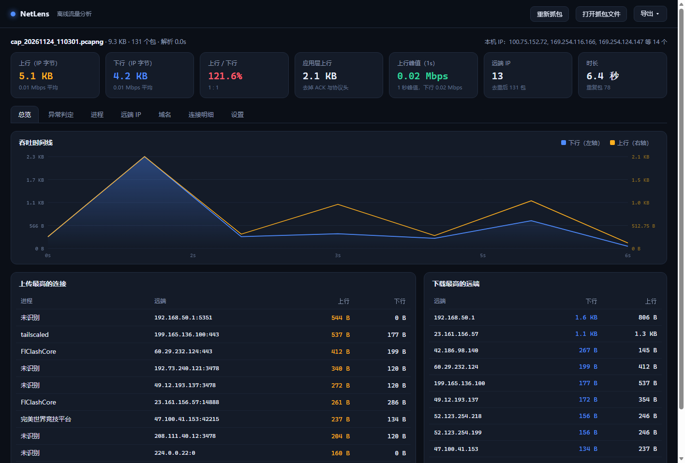

# NetLens · 本地流量分析（离线版）

一个**完全离线**的 Windows 抓包 + 浏览器分析小工具。双击运行，抓 3 分钟全量流量，自动在浏览器里
给出上下行总量、逐进程归属、远端 IP / 域名、以及针对 **PCDN、偷上传、异常回连** 的判定清单。

- 抓包用 Windows 自带 `pktmon`（无需安装 Wireshark / Npcap）
- 分析页面是纯静态 HTML/JS，零依赖、零联网，数据不出本机
- 也能直接拖入任意 `.pcapng` / `.pcap`（Wireshark、tcpdump 抓的都行）



## 环境要求

| 项目 | 要求 |
|---|---|
| 系统 | Windows 10 1809+ / Windows 11 |
| 权限 | **抓包需要管理员**（会弹 UAC）；只分析文件不需要 |
| 浏览器 | Edge / Chrome 等现代浏览器 |
| 运行时 | 系统自带 PowerShell 5.1（无需装 Python、Node） |
| 网络 | 全程不需要外网 |

## 快速开始

1. 双击 **`NetLens.cmd`**
2. UAC 弹窗点「是」
3. 控制台开始倒计时抓包（默认 180 秒，期间正常上网即可）
4. 抓完自动转换并启动本地服务，浏览器打开 `http://127.0.0.1:8765/`，页面自动载入本次抓包

关闭控制台窗口 = 停止服务。抓到的文件都在 `captures\`。

### 只分析已有文件

```powershell
.\NetLens.ps1 -ServeOnly          # 启动界面但不抓包
```

或者直接双击 `web\index.html`（file:// 打开），把 pcap 拖进页面 —— 这条路径不需要任何服务。

### 自定义

```powershell
.\NetLens.ps1 -Seconds 300 -Port 9000   # 抓 5 分钟，用 9000 端口
.\NetLens.ps1 -ServeOnly -NoBrowser     # 不自动开浏览器
```

## 界面

- **总览**：上下行卡片、双轴吞吐时间线（左轴下行 / 右轴上行）、上传最高连接、下载最高远端
- **异常判定**：7 项阈值检查，逐项给「正常 / 需注意」和实测值
- **进程 / 远端 IP / 域名 / 连接明细**：可过滤的连接表
- **导出**：Markdown 报告、CSV 连接明细、JSON 原始结果

## 判定规则

| 检查项 | 判定为异常的条件 |
|---|---|
| 持续上行速率 | > 2 Mbps 且超过下行 20% |
| 单条连接最大上传 | > 20 MB 或（> 2 MB 且占上行 30% 以上） |
| 多对端上传（PCDN 特征） | 单进程 ≥ 20 个远端且上行 > 300 KB |
| 公网主动连入 | 出现任何非内网来源的 TCP SYN |
| UDP 对多 IP 发送 | > 10 个远端且每个 > 20 KB |
| 未归属进程的上行 | > 1 MB 且占上行 10% 以上 |
| 上行峰值（1 秒） | > 10 Mbps |

阈值写在 `web\core.js` 的 `buildChecks()` 里，可直接改。

## 统计口径

- 字节数按 **IP 包长度** 统计（不含以太网帧头），与 Windows「网络」计数器略有差异属正常
- 「应用层上行」= 去掉 TCP/IP 头、去掉纯 ACK 之后的载荷字节，才是真正的"上传"
- pktmon 会在驱动多个组件重复记录同一个包，工具按「五元组 + 序号 + 载荷指纹 + 3ms 窗口」去重
- 进程归属来自抓包期间每秒采样的 `Get-NetTCPConnection`（本地端口 → PID）
- 域名来自 TLS SNI / HTTP Host / DNS 应答；**HTTPS 正文加密，走代理的站点无法逐站点归属**

## 目录结构

```
NetLens\
  NetLens.cmd            入口（双击）
  NetLens.ps1            提权 / 抓包调度 / 本地 HTTP 服务
  capture.ps1            实际抓包：pktmon + 每秒连接采样 + etl→pcapng
  web\                   纯静态分析界面
    index.html
    app.js               界面逻辑、图表、导出
    core.js              pcap/pcapng 解析 + 流量分析（浏览器/Node 通用）
  captures\              抓包结果（pcapng / conns.csv / meta.json / status.json）
```

## 常见问题

**Q：提示"无法与 PktMon 驱动程序通信，拒绝访问"？**
没有管理员权限。请从 `NetLens.cmd` 启动并在 UAC 点「是」；或只做文件分析（`-ServeOnly`）。

**Q：端口被占用？**
`NetLens.ps1` 会从 8765 起自动往后找可用端口，启动时控制台会打印实际地址。

**Q：抓到的包很少 / 上下行都是几十 KB？**
说明这 3 分钟机器基本空闲，这是正常的。想复现"看有没有偷跑"，可以在你怀疑的场景下再抓一次。

**Q：文件很大，浏览器卡？**
默认按 1024 字节截断抓包（`capture.ps1` 里 `--pkt-size 1024`），3 分钟通常 20–80 MB。要完整包改成
`--pkt-size 0`，但文件会大一个数量级。分析 400 MB 的 pcapng 约需 2–4 秒。

**Q：杀毒软件报警？**
工具会调用 `pktmon`（系统组件）并监听 127.0.0.1 的本地端口，属于正常行为；不放心的可以只把
`web\` 目录拷走，用浏览器直接打开离线分析。

## 卸载

删掉整个 `NetLens` 文件夹即可；不写注册表、不装服务、不留开机启动。

## 许可证

MIT，见 [LICENSE](LICENSE)。
